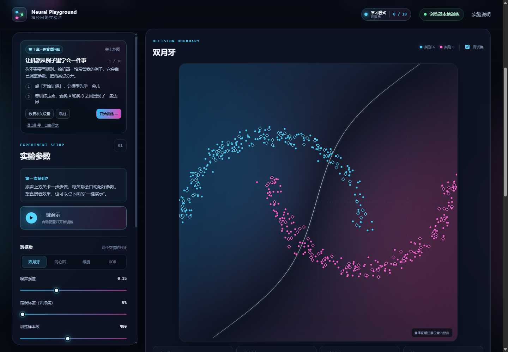
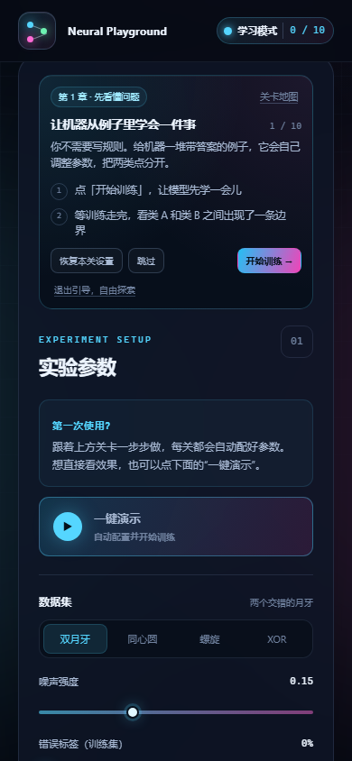

# Neural Playground · 神经网络实验台

一个完全在浏览器中训练和运行的交互式神经网络实验台。它把神经网络的基础知识拆成 10 个可操作的关卡：非专业用户不需要安装框架、不需要写代码，只要跟着关卡点击，就能从“一条直线为什么分不开两个圈”一路走到独立设计实验。所有计算都在浏览器里完成，没有后端，也没有 API Key。



## 在线演示

部署到 GitHub Pages 后，把仓库链接填写在这里：

```text
https://<你的 GitHub 用户名>.github.io/<仓库名>/
```

提交前请用无痕窗口和手机各打开一次，确认链接可以直接访问，而不是只上传了源码。

## 10 关学习路径

页面左侧的引导卡会自动配好每一关的数据集和模型，高亮下一步要点的控件，并在完成后给出本关结论。进度保存在浏览器本地，关掉页面再打开可以接着学。

| 关卡 | 主题 | 学到的概念 |
| --- | --- | --- |
| 1 | 让机器从例子里学会一件事 | 训练就是根据错误调整参数 |
| 2 | 一条直线，切不开一个圈 | 线性不可分 |
| 3 | 加一层隐藏层，边界就弯了 | 隐藏层与非线性表达 |
| 4 | 一个点进去，两个概率出来 | softmax 与置信度 |
| 5 | 读懂 2 → 16 → 8 → 2 | 网络结构、参数量、模型容量 |
| 6 | 训练轮数：同一批数据看几遍 | epoch 与收敛 |
| 7 | 学习率：每一步迈多大 | 学习率对优化的影响 |
| 8 | 标签错了，模型再强也没用 | 数据质量与错误标签 |
| 9 | 螺旋：把边界卷起来 | 复杂边界、容量与调参 |
| 10 | 毕业挑战：自己设计一次实验 | 独立选择数据、模型和参数 |

每关的完成条件都会被程序自动判定，例如“测试准确率低于 80%”“结构变成 2 → 16 → 8 → 2”“错误标签清零后准确率回升”。最后一关还有一道必须答对的理解题。



## 作品功能

- 四种二维分类数据集：双月牙、同心圆、螺旋、XOR。
- 三种模型：线性分类器、小型 MLP、深层 MLP。
- 10 关引导式学习路径，自动配置参数、自动判定过关、保存学习进度。
- 浏览器内实时训练，显示决策边界、损失曲线和准确率曲线。
- 训练集与测试集分离，实时展示测试准确率和混淆矩阵。
- 鼠标悬停在画布上，可以查看任意坐标的预测类别和置信度。
- 调节噪声、错误标签比例、样本数、学习率、训练轮数，观察数据质量与泛化的影响。
- 95% 测试准确率挑战，引导用户比较不同模型的表达能力。
- 一键演示模式，自动选择合适模型并开始训练。
- 导出决策边界截图和实验 JSON，便于写实验报告。
- 完全静态部署，无后端、无 API Key、无数据上传。

## 快速运行

### Windows

1. 确认已安装 Python 3。
2. 双击项目根目录的 `start.bat`。
3. 浏览器访问 `http://localhost:8000/`。

也可以在 PowerShell 中运行：

```powershell
python -m http.server 8000
```

### macOS / Linux

```bash
python3 -m http.server 8000
```

然后访问 `http://localhost:8000/`。

项目没有构建步骤，不需要 `npm install`。请通过本地 HTTP 服务打开，不要直接双击 `index.html`，因为浏览器会限制 ES Module 的本地文件加载。

## 项目结构

```text
.
├── index.html                   页面结构
├── styles.css                   视觉样式与响应式布局
├── js/
│   ├── main.js                  交互控制器、训练循环、画布渲染
│   ├── levels.js                10 关学习路径、过关判定与进度保存
│   ├── data.js                  四种二维数据集的生成逻辑
│   ├── network.js               从零实现的 MLP、反向传播与 Adam
│   ├── charts.js                损失/准确率曲线绘制
│   └── random.js                可复现随机数与高斯噪声
├── docs/
│   ├── EXPERIMENT_REPORT.md     实验报告模板
│   ├── AI_INTERACTION_LOG.md    AI 交互记录索引
│   ├── DEMO_SCRIPT.md           演示视频脚本
│   └── screenshots/             README 和提交材料使用的截图
├── start.bat                    Windows 本地启动脚本
└── .nojekyll                    GitHub Pages 配置
```

## 技术实现

### 数据

四个数据集都是在浏览器里用参数方程实时生成的合成数据，不是从网上下载的真实业务数据。它们对应机器学习课程中的标准玩具数据集：

- 双月牙：两个交错的半圆，对应 scikit-learn 的 `make_moons`。
- 同心圆：一个圆环包住另一个圆环，对应 `make_circles`。
- 螺旋：两条互相缠绕的臂，是神经网络可视化里的经典难题。
- XOR：异或问题，Minsky 和 Papert 用来说明单层感知机的局限。

训练集用于更新参数，测试集单独生成、不参与训练，只用于评估泛化能力。随机数使用固定种子（mulberry32 + Box-Muller 高斯噪声），同一组参数可以复现同一批数据和训练结果。

“错误标签（训练集）”滑杆会按比例翻转训练样本的标签，测试集始终保持干净。这样可以在不伪造结果的前提下，稳定演示“数据质量决定模型上限”。

### 网络

模型是一个小型多层感知机：

```text
输入 2 维 → [隐藏层] → 输出 2 类
```

- 隐藏层使用 `tanh` 激活函数。
- 输出层使用 softmax，得到两个类别的概率。
- 损失函数为交叉熵。
- 使用 mini-batch 梯度下降，batch size 默认 32。
- 使用 Adam 优化器更新权重和偏置。
- 线性分类器没有隐藏层，因此只能形成线性决策边界。

### 可视化

- 在 84 × 84 的网格上推理每个位置属于类别 B 的概率，生成决策边界热力图。
- 使用 marching squares 根据概率场提取平滑等高线。
- 训练集用圆点表示，测试集用菱形表示。
- 曲线和指标每轮训练后更新，不依赖任何图表库。

## 部署到 GitHub Pages

### 方法一：网页上传

1. 在 GitHub 新建一个公开仓库。
2. 点击 `Add file` → `Upload files`，上传本目录中的全部文件和文件夹。
3. 打开仓库的 `Settings` → `Pages`。
4. 在 `Build and deployment` 中选择 `Deploy from a branch`。
5. 分支选择 `main`，目录选择 `/ (root)`，保存。
6. 等待 Pages 构建完成，打开生成的链接检查页面。

`.nojekyll` 已经放在根目录，用于避免 GitHub Pages 对静态资源做额外处理。

### 方法二：使用 Git

如果本机安装了 Git，可以使用：

```bash
git init
git add .
git commit -m "feat: add neural playground"
git branch -M main
git remote add origin https://github.com/<用户名>/<仓库名>.git
git push -u origin main
```

然后在 GitHub 仓库设置中启用 Pages。

## 验证与测试

核心训练逻辑在 400 个训练样本、噪声 0.15、600 轮训练的配置下得到如下结果：

| 数据集 | 线性分类器 | 小型 MLP | 深层 MLP |
| --- | ---: | ---: | ---: |
| 双月牙 | 92.1% | 100% | 100% |
| 同心圆 | 50.7% | 100% | 100% |
| 螺旋 | 57.9% | 82.9% | 100% |
| XOR | 52.9% | 94.3% | 95.7% |

这组结果用于说明模型表达能力差异。准确率会随随机种子、噪声和训练参数变化，实验报告里应记录实际运行时得到的数值。

引导流程做了端到端浏览器测试：从第 1 关依次点到第 10 关，10 关全部自动判定通过，控制台 0 报错。关键节点为：第 2 关线性模型 51.8%；第 3 关小型 MLP 100%；第 8 关训练集混入 30% 错误标签时测试准确率 77.7%，清零后回到 100%；第 9 关螺旋 100%。

## 课程提交材料

- 作品源码：本仓库。
- 在线链接：部署后的 GitHub Pages 地址。
- 实验报告：`docs/EXPERIMENT_REPORT.md` 可作为模板，填写姓名、学号等信息后导出 PDF。
- AI 交互记录：`docs/AI_INTERACTION_LOG.md` 是索引，完整对话请从 Codex/ChatGPT 导出后作为附件提交。
- 演示视频：可参考 `docs/DEMO_SCRIPT.md` 录制 2–3 分钟视频。

## 已知限制

- 数据集是二维教学数据，不代表真实业务场景。
- 模型规模较小，目标是比较模型表达能力，而不是追求工业级精度。
- 学习进度保存在浏览器本地；模型权重和训练曲线不会保存，刷新后需要重新训练。
- JSON 导出包含配置、指标和训练历史，不包含模型权重。

本项目用于《人工智能基础与应用》课程作品展示。
